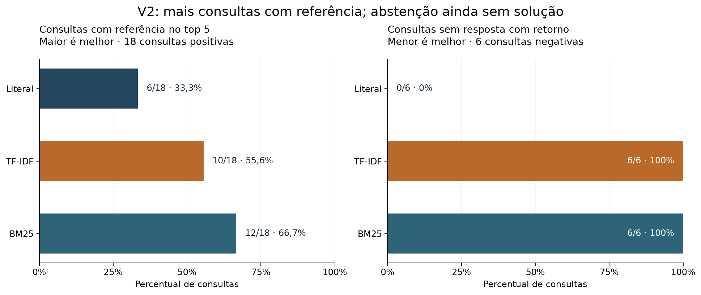

# Sherlock Document Search

Projeto de portfólio em Python que ajuda a localizar referências em um acervo documental: cada resultado aponta para a obra, o arquivo-fonte e as linhas do parágrafo original. O exemplo usa textos em inglês de Sherlock Holmes; a interface e a documentação são em português.

O projeto compara três formas de busca sobre os mesmos parágrafos:

- **Literal** — encontra palavras ou expressões exatas.
- **TF-IDF** — ordena correspondências lexicais por similaridade de cosseno.
- **BM25** — ordena correspondências lexicais com ponderação por frequência e tamanho do texto.

As pontuações de cosseno e BM25 não são probabilidades de resposta. TF-IDF e BM25 podem retornar passagens que compartilham termos com a consulta sem informar o detalhe solicitado.

## Leia o relatório

[Relatório Quarto no GitHub Pages](https://talesgomes27.github.io/sherlock-document-search/) · [Fontes e reprodução do relatório](docs/quarto-report.md)

O relatório reúne dados, métodos, resultados, análise das consultas sem resposta e histórico v1, com tabelas calculadas dos JSONs aprovados. A renderização não recalcula buscas nem ajusta modelos.

## Experimente no Kaggle

[Abra o notebook v2](notebooks/sherlock_document_search_v2.ipynb), importe-o como um notebook novo, anexe o [dataset Sherlock Holmes Series](https://www.kaggle.com/datasets/talesgomes27/sherleck-books), habilite Internet e execute todas as células. O notebook contém o código necessário: não precisa clonar o repositório. O corpus anexado é a entrada. A execução no Kaggle ainda não foi verificada.

O notebook apresenta os três métodos, gráficos, resultados para 18 consultas positivas e seis negativas e referências às linhas de origem. O gráfico abaixo resume o teste congelado.



| Método | Positivas com referência conhecida no top 5 | Negativas com retorno (falsos positivos neste teste) |
|---|---:|---:|
| Literal | 6/18 | 0/6 |
| TF-IDF | 10/18 | 6/6 |
| BM25 | 12/18 | 6/6 |

As referências conhecidas não são exaustivas, e um resultado pode ser evidência parcial. BM25 encontrou referência conhecida em mais consultas positivas que TF-IDF neste conjunto, mas ambos retornaram passagens nas seis consultas sem resposta. Isso não demonstra superioridade geral nem capacidade confiável de reconhecer ausência. Os conjuntos de avaliação v1 e v2 têm tamanhos diferentes; seus percentuais não devem ser agregados nem comparados diretamente.

## Executar localmente

Requer Python 3.11.17 e [uv](https://docs.astral.sh/uv/). Na raiz do repositório:

```bash
uv sync --managed-python --python 3.11.17 --frozen
uv run python -m sherlock_search --download
```

Use `--download` apenas na primeira obtenção; se os nove TXT já estiverem em `data/raw/`, pule esse comando. O download verifica os hashes e recusa sobrescrever a pasta existente. O corpus não é versionado no Git. A preparação gera parágrafos com localização verificável, usando as linhas do TXT original.

Exemplos de consulta:

```bash
uv run python -m sherlock_search --query "Cyanea"
uv run python -m sherlock_search --method tfidf --query "Cyanea"
uv run python -m sherlock_search.bm25 --query "Trichinopoly cigar"
```

Cada comando mostra resultados com obra, arquivo e intervalo de linhas de origem. A busca literal exige correspondência exata; os outros métodos classificam correspondências lexicais. [Preparação e comandos](docs/data-preparation.md) · [Reprodução da avaliação v2](docs/v2-final-evaluation.md).

Execute a suíte após preparar os dados:

```bash
uv run python -m unittest discover -s tests -q
```

A suíte tem 115 testes, incluindo integração com os dados reais. Sem os TXT, testes que dependem do corpus real são ignorados; essa execução não valida a integração real.

## Dados e proveniência

O corpus verificado contém **9 TXT**, **4.041.127 bytes**, **15.598 parágrafos** e **656.884 palavras retidas**; 29.566 palavras foram excluídas pelos recortes editoriais. Cada parágrafo preserva arquivo e linhas de origem. A fonte publicada é o [dataset no Kaggle](https://www.kaggle.com/datasets/talesgomes27/sherleck-books); detalhes de proveniência e pendências sobre publicação de trechos estão em [docs/provenance.md](docs/provenance.md). Os arquivos do corpus não ficam no Git.

## Histórico dos testes

A v1 está preservada na tag `v1-baseline` e no notebook original. A v2 adiciona BM25 em notebook próprio; os arquivos históricos permanecem nos caminhos originais.

| Experimento | Métodos | Consultas de desenvolvimento | Consultas finais |
|---|---|---:|---:|
| v1 | Literal, TF-IDF | 10 (8 positivas + 2 negativas) | 20 (16 positivas + 4 negativas) |
| v2 | Literal, TF-IDF, BM25 | 36 (27 positivas + 9 negativas) | 24 (18 positivas + 6 negativas) |

A v1 usou 16 positivas e quatro negativas; a v2 usou 18 e seis. Não agregue nem compare diretamente os percentuais desses grupos.

- [Notebook v1 preservado](notebooks/sherlock_document_search.ipynb) · [relatório v1](reports/m4_final.json)
- [Plano e desenvolvimento v2](docs/v2-plan.md) · [resultados de desenvolvimento](docs/v2-development.md)
- [Avaliação final v2 e reprodução](docs/v2-final-evaluation.md) · [diagnóstico das seis negativas](docs/v2-no-answer-analysis.md)

## Próximas etapas e limites

A v2 e seus resultados foram validados localmente; a execução atual do notebook no Kaggle ainda precisa ser conferida. O relatório Quarto do M5 reúne a análise no GitHub Pages. O dashboard Streamlit (M6) continua planejado e não foi iniciado. A avaliação em literatura não mede desempenho em documentos de clientes. O portfólio demonstra preparação de texto, recuperação de informação, avaliação e comunicação analítica.

## Documentação e artefatos

- [Instruções e validação do notebook Kaggle v2](docs/kaggle-notebook-v2.md)
- [Consultas e protocolo v1](docs/queries.md) · [revisão v1](docs/query-review.md)
- [Consultas finais v2](docs/v2-final-queries.md) · [desenvolvimento v2](evaluation/v2/development.json)
- [Relatório numérico da preparação](reports/m1_quality.json) · [manifesto do corpus](src/sherlock_search/corpus_manifest.json)
- [Busca literal e limites](docs/literal-search.md) · [TF-IDF e limites](docs/tfidf-search.md)
- [Planos geral](docs/plan.md) e [v2](docs/v2-plan.md) · [glossário inicial](GLOSSARY.md) · [registro de execução](task.md)

## English summary

Sherlock Document Search is a Python portfolio project for finding traceable references in the Sherlock Holmes corpus. It compares literal search, TF-IDF, and BM25; each result includes its source file and line range. The v2 test found known references in 6/18, 10/18, and 12/18 positive queries, respectively, while TF-IDF and BM25 returned results for all six negative queries. These results do not establish general superiority or performance on business documents. The v2 notebook includes its code for Kaggle and uses the attached dataset; hosted execution remains unverified.
