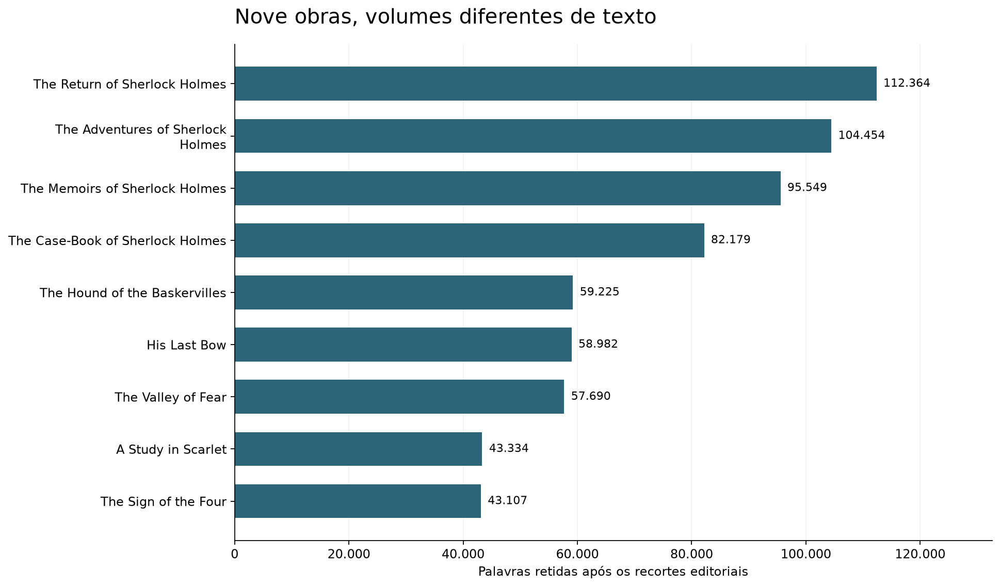
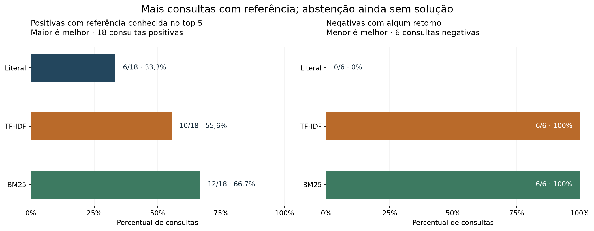
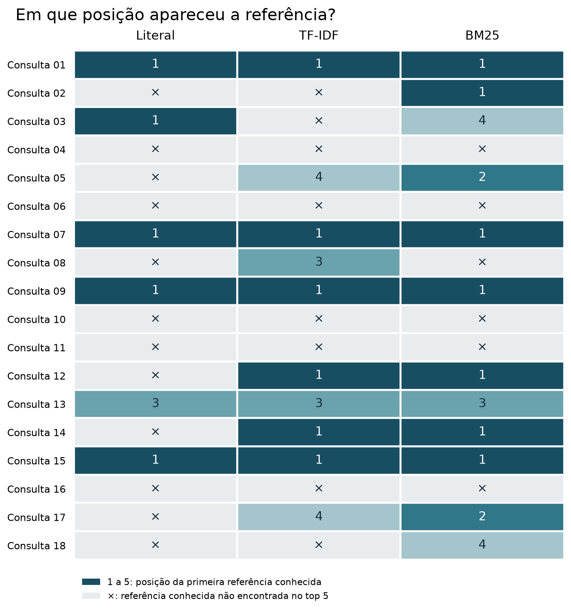

```{python}
#| label: report-sources
#| include: false
from pathlib import Path
import sys

ROOT = Path.cwd().parent
sys.path.insert(0, str(ROOT / "scripts"))
from verify_report_sources import verify_report_sources

data = verify_report_sources(ROOT)
v1 = data["v1"]
v2 = data["v2"]
corpus = data["corpus"]
queries = data["queries_v2"]


def number(value):
    return f"{value:,}".replace(",", ".")


def markdown_table(headers, rows, caption, label):
    print("| " + " | ".join(headers) + " |")
    print("| " + " | ".join("---" for _ in headers) + " |")
    for row in rows:
        print("| " + " | ".join(str(value).replace("|", "\\|") for value in row) + " |")
    print(f"\n: {caption} {{#{label}}}\n")
```

O projeto localiza passagens e informa o arquivo e as linhas de origem para que o leitor possa conferi-las. No teste v2, consultas positivas são aquelas para as quais há referências conhecidas; BM25 encontrou essas referências em mais consultas do que os outros métodos. Consultas negativas pedem detalhes plausíveis que não aparecem no contexto examinado. TF-IDF e BM25 retornaram passagens para todas elas.

O projeto demonstra como localizar referências ao ler um acervo e como uma passagem relacionada ao tema ainda pode deixar de informar o detalhe pedido. Esse fluxo pode ajudar pequenas equipes que precisam voltar à fonte ao consultar documentos. O portfólio reúne preparação de texto, comparação de métodos e avaliação; o experimento com literatura não mede desempenho em documentos de clientes.

## Do TXT à referência verificável

O acervo vem do [dataset Sherlock Holmes Series no Kaggle](https://www.kaggle.com/datasets/talesgomes27/sherleck-books). Os nove TXT identificam Arthur Conan Doyle e declaram inglês nos cabeçalhos. Uma lista de identificadores calculados a partir dos arquivos, chamados hashes, permite conferir quais arquivos foram utilizados, conforme a [proveniência documentada](https://github.com/talesgomes27/sherlock-document-search/blob/main/docs/provenance.md).

A preparação lê os arquivos em UTF-8, trata em memória o marcador BOM (que pode aparecer no início do arquivo) e os terminadores de linha, e preserva os originais. Os recortes editoriais removem créditos, prefácios, sumários e rodapés definidos durante a revisão. Cada parágrafo mantém a obra, o arquivo e o intervalo de linhas de origem, incluindo as duas extremidades. A contagem começa em 1 no TXT original. Notas editoriais internas e alguns títulos ainda podem permanecer, pois o projeto não tem uma rotina geral para separar todos os contos ou capítulos.

```{python}
#| label: corpus-counts
#| echo: false
#| output: asis
counts = corpus["totals"]
markdown_table(
    ["Medida", "Quantidade"],
    [
        ["Arquivos TXT", number(counts["files"])],
        ["Parágrafos retidos", number(counts["paragraphs"])],
        ["Palavras retidas", number(counts["retained_words"])],
        ["Palavras excluídas pelos recortes", number(counts["removed_words"])],
    ],
    "Contagens do relatório de preparação; palavras seguem a regra Unicode registrada na fonte.",
    "tbl-corpus",
)
```

{#fig-corpus fig-alt="Gráfico de barras horizontais das palavras retidas nas nove obras. The Return of Sherlock Holmes tem o maior volume, com 112.364 palavras, e The Sign of the Four o menor, com 43.107."}

A @fig-corpus compara o volume de texto de cada obra. A @tbl-corpus resume o material preparado. O total de palavras excluídas não mede toda a interferência editorial nem a qualidade da busca.

## Três métodos sobre os mesmos parágrafos

Cada método pode devolver até cinco parágrafos, com a localização de cada um. A busca literal procura uma sequência exata. TF-IDF transforma os termos em vetores e ordena os parágrafos pela similaridade de cosseno, uma medida de semelhança entre vetores. A implementação usa `TfidfVectorizer(stop_words="english")`, conforme a [documentação do scikit-learn](https://scikit-learn.org/stable/modules/feature_extraction.html#tfidf-term-weighting). BM25 considera a frequência dos termos e o comprimento do parágrafo. O parâmetro `k1=1,2` controla quanto a repetição de um termo aumenta seu peso; `b=0,75` controla a normalização pelo tamanho. A [documentação do Lucene](https://lucene.apache.org/core/10_3_1/core/org/apache/lucene/search/similarities/BM25Similarity.html) descreve esses parâmetros e a fórmula IDF que serviu de referência para a implementação própria.

| Método | Sinal usado para ordenar | Limite relevante |
|---|---|---|
| Literal | Ocorrências da sequência exata | Uma paráfrase pode não corresponder. |
| TF-IDF | Similaridade de cosseno entre vetores de termos | Um termo compartilhado pode gerar retorno insuficiente. |
| BM25 | Pesos dos termos, frequência e tamanho | Um score alto pode refletir apenas relação temática. |

TF-IDF e BM25 usam `min_score=0,0`, mas descartam resultados com score zero. Qualquer correspondência entre termos com peso positivo pode entrar entre os cinco primeiros resultados. As pontuações têm escalas diferentes e não são probabilidades de resposta.

## Um teste separado antes da execução

Durante o desenvolvimento da v2, foram reunidas 36 consultas: 27 positivas e nove negativas. Um curador diferente criou as 24 consultas finais. As referências positivas vêm de regiões diferentes, e houve revisão para identificar intenções sobrepostas. O autor aprovou os dois grupos no chat antes do congelamento. Esse registro não comprova uma auditoria humana individual de cada consulta.

A avaliação final usa 18 consultas positivas, divididas igualmente entre perguntas exatas, paráfrases e perguntas de contexto, além de seis negativas. Uma consulta positiva tem referências conhecidas, embora a lista possa estar incompleta. Uma consulta negativa pede um detalhe plausível que não aparece no contexto examinado. Essa revisão não prova que o detalhe esteja ausente de todo o acervo.

O [congelamento em `14a0913`](https://github.com/talesgomes27/sherlock-document-search/commit/14a0913) aconteceu antes da execução final. Depois dele, não foram alterados parâmetros, rótulos nem recortes. A [decisão de configuração](https://github.com/talesgomes27/sherlock-document-search/blob/main/evaluation/v2/configuration_decision.json) registra que o corte BM25 32 foi rejeitado durante o desenvolvimento: ele eliminou todos os 12 acertos positivos conhecidos. Na avaliação final, BM25 apenas ordenou os resultados, sem uma regra adicional para não responder quando a evidência é insuficiente.

## Mais referências recuperadas, com retornos indevidos

A @tbl-results compara os métodos nas mesmas 24 consultas. Para as positivas, conta-se um acerto quando ao menos uma referência conhecida aparece entre os cinco primeiros resultados. Esse resultado pode ser evidência parcial. Para as negativas, qualquer passagem retornada conta como falso positivo.

```{python}
#| label: final-results
#| echo: false
#| output: asis
method_names = {"literal_v1": "Literal", "tfidf_v1": "TF-IDF", "bm25": "BM25"}
rows = []
for key, name in method_names.items():
    result = v2["methods"][key]
    rows.append([
        name,
        f'{result["positive_hits"]}/{result["positive_queries"]}',
        f'{result["false_positive_queries"]}/{result["negative_queries"]}',
        f'{result["mrr_at_5"]:.4f}'.replace(".", ","),
    ])
markdown_table(
    ["Método", "Positivas com referência no top 5", "Negativas com retorno", "MRR@5 nas positivas"],
    rows,
    "Teste final v2: denominadores de 18 positivas e seis negativas, avaliadas separadamente.",
    "tbl-results",
)
```

MRR@5 é a média de um escore calculado nas 18 consultas positivas: vale 1 se a primeira referência conhecida aparece na primeira posição, 1/2 se aparece na segunda, 1/3 na terceira, e assim por diante até a quinta. A consulta recebe zero se não aparece entre os cinco primeiros. O escore reflete as anotações disponíveis, que podem não incluir todas as referências.

{#fig-comparison fig-alt="Dois gráficos de barras horizontais. Nas positivas, literal encontra referência conhecida em 6 de 18 consultas, TF-IDF em 10 e BM25 em 12. Nas seis negativas, os retornos são zero, seis e seis, respectivamente."}

Na @fig-comparison, BM25 encontra referências conhecidas em duas consultas positivas a mais que TF-IDF e tem MRR@5 maior. Os dois métodos retornaram passagens nas seis consultas negativas. A busca literal encontrou menos referências e não retornou passagens para essas perguntas. Uma informação pode estar escrita com outras palavras e passar despercebida pela busca literal. O teste é pequeno e foi curado; seus resultados não demonstram superioridade geral.

### Em quais consultas a referência apareceu?

A @fig-positions permite acompanhar cada pergunta, em vez de olhar apenas os totais. Um número mostra a posição da primeira referência conhecida; a marca × indica que ela não apareceu entre os cinco primeiros resultados. Isso não descarta a relevância de outros trechos nem confirma que toda a evidência pedida foi recuperada.

{#fig-positions fig-alt="Matriz com 18 consultas e três métodos. Cinco consultas não têm referência conhecida recuperada por nenhum método. Na consulta 08, TF-IDF encontra a referência na terceira posição e BM25 não a encontra nos cinco primeiros. Os totais de consultas com referência são seis, dez e doze."}

Cinco consultas ficaram sem referência conhecida no top 5 dos três métodos. A consulta 08 mostra uma perda do BM25 em relação ao TF-IDF; já as consultas 02 e 18 têm referência conhecida recuperada apenas pelo BM25. Os IDs completos e as perguntas estão nas [consultas finais publicadas](https://github.com/talesgomes27/sherlock-document-search/blob/main/evaluation/v2/final.json). A matriz descreve este teste, sem ajustar a busca a partir dele.

### Por que uma pergunta sem resposta recebe resultado

A @tbl-negatives mostra as pontuações já calculadas para as seis consultas negativas. As descrições resumem as [consultas finais publicadas](https://github.com/talesgomes27/sherlock-document-search/blob/main/evaluation/v2/final.json). Os valores vêm do relatório e não de uma nova busca.

```{python}
#| label: negative-results
#| echo: false
#| output: asis
details = {
    "v2-final-19": "Idades dos cavalos de Jefferson Hope",
    "v2-final-20": "Preço do caixão entregue em Poultney Square",
    "v2-final-21": "Tarifa ferroviária de Reading a Eyford",
    "v2-final-22": "Nome do navio esperado para Selden",
    "v2-final-23": "Peso exato do cofre vazio de Agra",
    "v2-final-24": "Calibre da munição que matou Menzies",
}
negative_queries = {query["id"]: query for query in queries if not query["answerable"]}
rows = []
for result in v2["results"]:
    if result["id"] in negative_queries:
        rows.append([
            result["id"],
            details[result["id"]],
            f'{result["tfidf_v1"][0]["score"]:.4f}'.replace(".", ","),
            f'{result["bm25"][0]["score"]:.4f}'.replace(".", ","),
            len(result["literal_v1"]),
        ])
markdown_table(
    ["ID", "Detalhe solicitado", "TF-IDF top 1", "BM25 top 1", "Retornos literais"],
    rows,
    "Seis consultas negativas: scores do primeiro resultado e quantidade de retornos literais. As escalas TF-IDF e BM25 não são comparáveis.",
    "tbl-negatives",
)
```

O [diagnóstico dos top 1](https://github.com/talesgomes27/sherlock-document-search/blob/main/docs/v2-no-answer-analysis.md) compara o tema da passagem com o atributo pedido. Menções a cavalos e a um local não informam idade; uma entrega e um endereço não indicam preço. Passagens sobre jornada, América do Sul, tesouro ou ataque também podem não informar tarifa, nome do navio, peso ou calibre. Essas relações ajudam a entender por que os métodos retornaram os trechos, embora eles não respondam às perguntas.

Uma versão futura precisaria tratar separadamente a ordem dos resultados e a decisão de não responder. Seria possível testar se os trechos cobrem os atributos pedidos, se há uma margem suficiente entre candidatos ou usar um avaliador de pares de pergunta e passagem. Antes de ajustar os métodos, seria necessário reservar um novo teste independente, pois os conjuntos v2 já foram examinados e divulgados.

## Reproduzir e conferir a evidência

Este relatório lê arquivos JSON existentes e confere seus hashes antes de gerar as tabelas. Ao renderizar a página, não ajusta modelos nem executa buscas. As duas figuras de resumo vêm dos artefatos aprovados; a matriz por consulta foi montada a partir dos mesmos resultados salvos. O código e os resultados permitem conferir as etapas que ligam os dados às conclusões:

- [Notebook v2 para leitura e Kaggle](https://github.com/talesgomes27/sherlock-document-search/blob/main/notebooks/portfolio/sherlock_document_search_v2.ipynb) e [notebook v1 para leitura e Kaggle](https://github.com/talesgomes27/sherlock-document-search/blob/main/notebooks/portfolio/sherlock_document_search_v1.ipynb), com código para executar após anexar o dataset. São edições de apresentação; os [notebooks originais validados](https://github.com/talesgomes27/sherlock-document-search/tree/main/notebooks) permanecem preservados.
- [Resultado final v2 por consulta](https://github.com/talesgomes27/sherlock-document-search/blob/main/reports/v2/final.json), [contagens do corpus](https://github.com/talesgomes27/sherlock-document-search/blob/main/reports/m1_quality.json) e [validação v2](https://github.com/talesgomes27/sherlock-document-search/blob/main/reports/v2/validation.json).
- [Protocolo e comandos de reprodução](https://github.com/talesgomes27/sherlock-document-search/blob/main/docs/v2-final-evaluation.md), com saída nova para preservar o snapshot original.

Os resultados e notebooks têm validação local registrada; a execução do notebook hospedado no Kaggle ainda não foi verificada. O material entregue é um relatório de evidências, e a aplicação interativa continua como etapa futura. A página publica contagens, metadados e paráfrases das consultas. A documentação de proveniência ainda registra como pendente a verificação das condições de uso e atribuição para exibir trechos das obras.

::: {.callout-note collapse="true"}
## Histórico v1: outro conjunto, outros denominadores

A [v1 preservada em `8f17985`](https://github.com/talesgomes27/sherlock-document-search/commit/8f179855a8c1c445afb122bf70ef4dd8512f9e7f) avaliou 20 consultas: 16 positivas, com referências conhecidas, e quatro negativas com perguntas anacrônicas, que incluem elementos de outra época. A @tbl-history mostra os resultados originais da v1. Seus percentuais não devem ser combinados nem comparados diretamente com os da avaliação v2, que usou 24 consultas.

```{python}
#| label: historical-results
#| echo: false
#| output: asis
rows = []
for key, name in [("literal", "Literal"), ("tfidf", "TF-IDF")]:
    result = v1[key]
    rows.append([
        name,
        f'{result["positive_hits"]}/{result["positive_queries"]}',
        f'{result["false_positive_queries"]}/{result["negative_queries"]}',
    ])
markdown_table(
    ["Método", "Positivas com referência no top 5", "Negativas com retorno"],
    rows,
    "Histórico v1: 16 positivas e quatro negativas, segundo o relatório original.",
    "tbl-history",
)
```

[Relatório v1 original](https://github.com/talesgomes27/sherlock-document-search/blob/main/reports/m4_final.json).
:::

## English summary

Sherlock Document Search compares literal search, TF-IDF and BM25 over traceable paragraphs from nine Sherlock Holmes TXT files. Positive queries have known references; negative queries ask for plausible details absent from the inspected context. In the same v2 test, the methods retrieved known references for 6/18, 10/18 and 12/18 positive queries. TF-IDF and BM25 returned results for all six negative queries, while literal search returned none. This small curated test does not establish general superiority, business performance or reliable abstention. Any tuning requires a new independent test. Results were validated locally.
